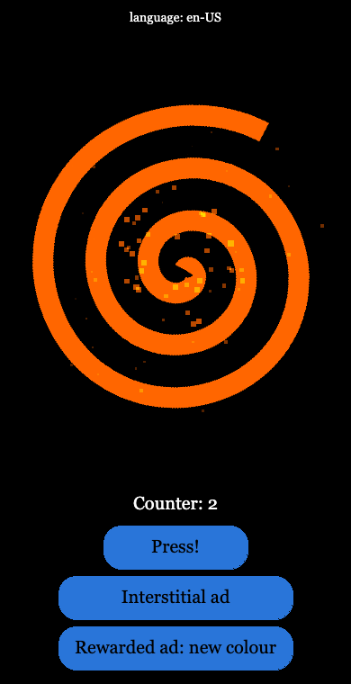

# melonJS YouTube Playables Template

A starter project for building [YouTube Playables](https://developers.google.com/youtube/gaming/playables)
with [melonJS](https://github.com/melonjs/melonJS), using TypeScript and Vite.

The game itself is kept tiny on purpose. It is the same one as in the
[plain HTML/JS/CSS sample](../plain-html-js-css): a spinning spiral, a counter
and two ad buttons. What matters is the code around it, which handles
everything the [Playables SDK](https://developers.google.com/youtube/gaming/playables/reference/sdk)
asks of a game, the way melonJS expects it.



## What's in the game

- **Press!** adds one to a counter. The counter is saved to YouTube's cloud
  save and sent to YouTube as the player's score. Each press also makes the
  spiral pop, throws a burst of sparks and plays a note.
- **Interstitial ad** asks YouTube to show an ad.
- **Rewarded ad: new colour** asks for a rewarded ad. When the player earns
  the reward, the spiral changes colour, with a little chime, and the colour is
  saved too.
- The game follows YouTube's pause, resume and mute, and speaks the player's
  YouTube language (English, French and Spanish are included).
- It plays with touch, a mouse or the keyboard.

Outside YouTube, in a normal browser tab, the same game still runs: it saves
to `localStorage` and pauses when you switch tabs, like any melonJS game.

### melonJS features it uses

- a `Stage` for the game screen, and the loader with its loading screen
- `Sprite`, tinted, for the spiral, and `Text` for the labels
- `UITextButton` for the buttons, with keyboard focus built in, and a
  `UIPanel` that stacks them
- a `Tween` for the pop, with an elastic easing
- a `ParticleEmitter` for the sparks, with no image needed
- `audio.playTrack()` for the music, and `audio.tone()` for the notes, which
  are generated on the fly, so there are no sound files to ship
- `save` for the progress, pointed at YouTube's cloud save
- `"flex"` scaling, so the game fits any screen shape

## Requirements

- [Node.js](https://nodejs.org) 24 or later
- [melonJS](https://www.npmjs.com/package/melonjs) 20.15 or later
- [Vite](https://vite.dev) 8 and [TypeScript](https://www.typescriptlang.org) 6,
  installed with the project

## Getting started

| Command | What it does |
|---------|--------------|
| `npm install` | Installs the dependencies |
| `npm run dev` | Starts a development server on `http://localhost:8080`, with live reload |
| `npm run build` | Type-checks the code and builds the game into `dist` |
| `npm run preview` | Serves `dist` on `http://localhost:8080` |

## Testing with the SDK Test Suite

The SDK does nothing when the game runs on its own. To see the integration
working, load the game in Google's
[Playables SDK Test Suite](https://developers.google.com/youtube/gaming/playables/test_suite):

1. Run `npm run build`, then `npm run preview`.
2. Open the Test Suite and enter `http://localhost:8080` as the game URL.
3. Chrome will ask whether the page may access your local network. Allow it:
   that's how it reaches your local server.

The Test Suite checks the integration while the game loads, logs every SDK
call, and lets you pause, mute, change the language, clear the save and
answer ad requests. This template passes all of its checks.

Use the production build for this. The development server works too, but it
serves files like `/@vite/client`, which fail the file name check.

Both local servers send the same `Content-Security-Policy` header YouTube uses
(see `vite.config.ts`), so anything YouTube would block shows up as an error in
your console first.

## Project structure

| File | Contents |
|------|----------|
| `index.html` | Loads the Playables SDK first, then the game |
| `src/main.ts` | Start-up: creates the application, loads the save and the assets, starts the game |
| `src/youtube.ts` | Every call to the Playables SDK |
| `src/play-screen.ts` | The game screen |
| `src/strings.ts` | The game's text, in English, French and Spanish |
| `src/types/sdk.d.ts` | Types for the `ytgame` global, taken from the [PixiJS sample](../pixijs) |
| `public/` | The spiral and the music |
| `vite.config.ts` | Relative paths for the build, and YouTube's security policy for the local servers |

## How the integration works

All the YouTube code is in `src/youtube.ts`. Each function checks
`inPlayables` first and does nothing outside YouTube:

```ts
export const inPlayables =
  typeof ytgame !== "undefined" && ytgame.IN_PLAYABLES_ENV;
```

### Loading the SDK

The SDK has to load before any game code, so it is the first script in
`index.html`:

```html
<script src="https://www.youtube.com/game_api/v1"></script>
```

### Saving progress

A Playable can only save progress to YouTube's cloud save, and has to load
that save before writing to it. melonJS saves through its `save` object, which
uses `localStorage` by default. `useCloudSave()` loads the cloud save, then
hands `save` a storage made by `save.createCloudStorage()`:

```ts
const cloud = save.createCloudStorage({
  data: await ytgame.game.loadData(),
  write: (items) => ytgame.game.saveData(JSON.stringify(items)),
});
save.setStorage(cloud);
ytgame.system.onPause(() => cloud.flush());
```

The storage keeps everything in memory and saves it back to YouTube in the
background: the changes made together in one save, and one save at a time.
`flush()` saves straight away, which YouTube recommends when it pauses the
game. The game never deals with the cloud itself; it just uses `save`:

```ts
const progress = save.add({ counter: 0, color: 0 });
progress.counter += 1;   // saved to the cloud
```

If the save can't be loaded, or a save fails, the error is reported with
`ytgame.health.logError()`. A save that failed is tried again with the next
change, and a game whose save can't be loaded starts fresh.

### Pausing and resuming

When YouTube calls `onPause`, the game has to stop completely: game loop,
rendering, sound and input. It may only resume on `onResume`, and it can't use
the browser's own focus or visibility events for any of this.

melonJS already knows how to pause a game when the player switches away, so
the template hands it YouTube's events instead of the browser's:

```ts
app.stopOnBlur = true;
app.pauseOnBlur = false;
device.setFocusEvents(false);
ytgame.system.onPause(() => event.emit(event.BLUR));
ytgame.system.onResume(() => event.emit(event.FOCUS));
```

There are two settings at play here:

- `device.setFocusEvents(false)` decides **who** reports that the player left.
  It stops the browser window from doing it, so only YouTube does.
- The `pauseOnBlur`, `stopOnBlur` and `resumeOnFocus` flags decide **what**
  the game does about it. `stopOnBlur` stops the loop and the rendering,
  pauses the music, mutes the sound effects and releases held keys. On resume
  melonJS undoes exactly that, and leaves alone anything the game paused or
  muted itself.

Turning the flags off would not work: they apply to YouTube's events as well,
so YouTube's pause would do nothing.

### Sound

YouTube's mute always wins. The game reads `isAudioEnabled()` at start-up and
then follows `onAudioEnabledChange()`:

```ts
const setSound = (enabled: boolean) => enabled ? audio.unmuteAll() : audio.muteAll();
setSound(ytgame.system.isAudioEnabled());
ytgame.system.onAudioEnabledChange(setSound);
```

Since YouTube is the mute switch, the game has no mute button of its own.
Separate music and effects volumes would be fine.

The music starts on the player's first tap or key press. Browsers keep audio
locked until then, and melonJS unlocks it on that first gesture.

### Loading screen and game ready

YouTube shows a spinner until the game calls `firstFrameReady()`, which must
happen while a loading screen is visible. Then it waits for `gameReady()`,
which must only come once the game can actually be played.

`watchLoadingScreen()` sends `firstFrameReady()` on the first frame of
melonJS's loading screen. The game screen calls `gameReady()` when it starts.

YouTube may load the game in a frame that has no height yet. That's why the
application starts at a fixed 360 × 640 and uses `"flex"` scaling, which
resizes the canvas to the frame once it gets its real size.

### Score

`sendScore()` sends a whole number. YouTube expects the best score sent to
match the best score in the save. Here the counter only ever goes up, so they
always match.

### Ads

Both ad calls are wrapped so a failed request never blocks the game.

A rewarded ad uses a fixed ID for each kind of reward, with no user data in it
(`"spiral-color"` here). The reward is only given when the call returns `true`;
a player who closes the ad early gets nothing. An interstitial ad is never a
reward.

### Language

`ytgame.system.getLanguage()` gives the player's YouTube language, such as
`fr-FR`. Playables should use it rather than the browser's language.
`stringsFor()` in `src/strings.ts` picks the matching translation, and falls
back to English. Outside YouTube, the browser's language is used instead.

The language is shown at the top of the screen. In development builds the SDK
version appears next to it; YouTube asks that it isn't shown in production.

### Touch, mouse and keyboard

Playables must work with touch and with a mouse, and should work with a
keyboard. The buttons are melonJS UI buttons, which handle all three:

- touch and mouse work out of the box;
- the **Press!** button gets the keyboard focus when the game starts, so the
  arrow keys move between the buttons and Enter or Space presses them.

The buttons are 48 pixels high, with 8 pixels between them, following
YouTube's recommended touch target size.

## Building for YouTube

`npm run build` puts the game in `dist`, with relative paths, so it works
wherever YouTube hosts it. Upload the contents of `dist` in the
[Playables Developer Portal](https://developers.google.com/youtube/gaming/playables/developer_portal).

Keep an eye on the
[size limits](https://developers.google.com/youtube/gaming/playables/certification/requirements_stability)
as your game grows:

- **Initial download**: about 760 KiB for this template, out of 30 MiB allowed
  (15 MiB recommended).
- **File size**: the JavaScript bundle is about 990 KB (300 KB compressed),
  mostly melonJS. That's over the recommended 512 KiB per file, but far below
  the 30 MiB limit, and it's why `npm run build` warns about a chunk larger
  than 500 kB. Try to keep your own assets under 512 KiB each.
- **File names**: only letters, digits, `-`, `_` and `.` are allowed. Vite's
  output follows this; name your own assets the same way.

## Using AI coding assistants

melonJS comes with **skills**: guides that teach AI coding assistants how the
engine works, and especially the mistakes that fail silently. They ship with
the package in `node_modules/melonjs/skills/`, so they always match your
installed version.

To install them for your assistants:

```bash
npx skills add https://github.com/melonjs/melonJS/tree/master/packages/melonjs/skills
```

In Claude Code, you can use the melonJS plugin instead:
`/plugin marketplace add melonjs/melonJS`. For tools that read an `AGENTS.md`
(Codex, Cursor, Gemini CLI), copy the one from the package:
`cp node_modules/melonjs/skills/AGENTS.md ./AGENTS.md`.

The skills that matter most for this template:

- `melonjs-platforms`: YouTube Playables, and how a game hands pausing,
  saving and sound to the platform it runs on
- `melonjs-scenes-and-state`: `save`, `save.setStorage()` and
  `save.createCloudStorage()`, pausing, and `device.setFocusEvents()` versus
  the pause flags
- `melonjs-audio`: music, muting, and unlocking audio
- `melonjs-ui-and-text`: buttons, panels, keyboard focus and text
- `melonjs-display-and-scaling`: the `"flex"` scaling
- `melonjs-loading-assets`: the loader and its loading screen

For anything else, the full API is indexed at
[llms.txt](https://melonjs.github.io/melonJS/llms.txt).

## Assets

- `spiral.svg` comes from the plain HTML/JS/CSS sample, where it was made in
  Inkscape. It has been made white here, so the game can tint it.
- `moonlight.mp3` is the first movement of Beethoven's "Moonlight" Sonata, in
  the public domain via
  [Wikimedia Commons](https://commons.wikimedia.org/wiki/File:Ludwig_van_Beethoven_-_sonata_no._14_in_c_sharp_minor_%27moonlight%27,_op._27_no._2_-_i._adagio_sostenuto.ogg),
  like in the other samples. It has been re-encoded to 56 kbps mono to stay
  under 512 KiB.

## Learn more

- [melonJS documentation](https://melonjs.github.io/melonJS/),
  [examples](https://melonjs.github.io/melonJS/examples/) and
  [skills](https://github.com/melonjs/melonJS/tree/master/packages/melonjs/skills)
- [YouTube Playables documentation](https://developers.google.com/youtube/gaming/playables)
- [Playables publishing requirements](https://developers.google.com/youtube/gaming/playables/certification/requirements)
