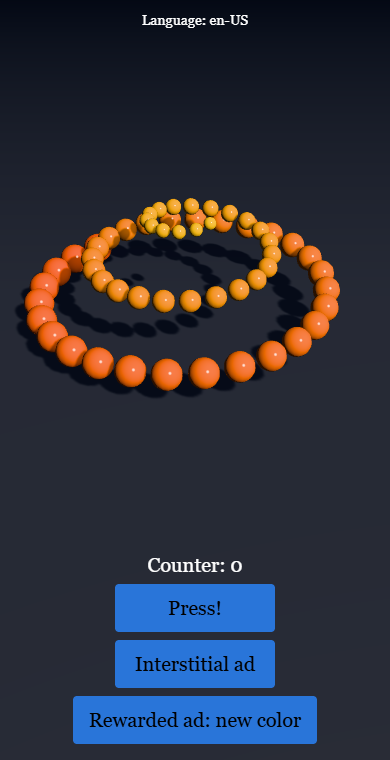

# PlayCanvas YouTube Playables Template

A starter project for building [YouTube Playables](https://developers.google.com/youtube/gaming/playables)
with the [PlayCanvas Engine](https://github.com/playcanvas/engine), using
TypeScript and Vite.

The game is kept small on purpose. It is the one from the
[plain HTML/JS/CSS sample](../plain-html-js-css), in 3D: a coil of glossy beads
in place of the flat spiral, a counter and two ad buttons. What matters is the
code around it, which does what the
[Playables SDK](https://developers.google.com/youtube/gaming/playables/reference/sdk)
asks of a game, the PlayCanvas way.



## What's in the game

- **Press!** adds one to the counter. The beads hop one after another, from
  the center out, and the coil spins faster for a moment. The counter is saved
  to YouTube's cloud save and sent to YouTube as the player's score.
- **Interstitial ad** asks YouTube for an ad.
- **Rewarded ad: new color** asks for a rewarded ad. If the player earns the
  reward, the coil changes colors, and the colors are saved too.
- The game follows YouTube's pause, resume and mute, and uses the player's
  YouTube language (English, French and Spanish are included).
- It works with touch, a mouse or a keyboard.

Outside YouTube, in a normal browser tab, the game still runs. It saves to
`localStorage` instead, so you can test saving without the SDK, and ads do
nothing.

## Requirements

- [Node.js](https://nodejs.org) 20.19 or 22.12 or later
- [PlayCanvas Engine](https://www.npmjs.com/package/playcanvas) 2.24 or later,
  [Vite](https://vite.dev) 8 and [TypeScript](https://www.typescriptlang.org) 7,
  all installed with the project

## Getting started

| Command | What it does |
|---------|--------------|
| `npm install` | Installs the dependencies |
| `npm run dev` | Starts a development server on `http://localhost:8080`, with live reload |
| `npm run build` | Type-checks the code and builds the game into `dist` |
| `npm run preview` | Serves `dist` on `http://localhost:8080` |

## Testing with the SDK Test Suite

Outside YouTube the SDK does nothing. To see the integration working, load
the game in the
[Playables SDK Test Suite](https://developers.google.com/youtube/gaming/playables/test_suite):

1. Run `npm run build`, then `npm run preview`.
2. Open the Test Suite in Chrome and enter `http://localhost:8080` as the
   game URL.
3. When Chrome asks whether the page may access your local network, allow it.

The Test Suite checks the integration while the game loads, logs every SDK
call, and lets you pause, mute, change the language, clear the save and answer
ad requests.

Use the production build. The development server works too, but it serves
files such as `/@vite/client`, which fail the file name check.

Both local servers send the `Content-Security-Policy` header YouTube serves
Playables with (see `vite.config.ts`), so anything YouTube would block shows up
in your browser console first.

## Project structure

| File | Contents |
|------|----------|
| `index.html` | Loads the Playables SDK first, then the game. Holds the loading bar and the interface |
| `src/main.ts` | Start-up: creates the app, shows the loading screen, loads the save, starts the game |
| `src/youtube.ts` | Every call to the Playables SDK |
| `src/game.ts` | The scene, the camera framing, the interface and the save format |
| `src/coil.ts` | Builds the coil, and a PlayCanvas `Script` that spins it and makes the beads hop |
| `src/strings.ts` | The game's text in English, French and Spanish |
| `src/style.css` | The loading screen and the interface |
| `src/types/sdk.d.ts` | Types for the `ytgame` global, from the [PixiJS sample](../pixijs) |
| `public/` | The music |
| `vite.config.ts` | Relative paths for the build, and YouTube's security policy for the local servers |

## How it is built

PlayCanvas draws the 3D scene:

- **The coil**: 57 beads made with the engine's sphere primitive, each with its
  own `StandardMaterial` for the color gradient. A `Script` on the coil spins
  it, runs a gentle wave along it, and makes the beads hop after a press.
- **The lighting**: one warm directional key light with soft shadows, a cool
  ambient fill, neutral tone mapping, and fog that fades the floor into the
  background.
- **The camera** looks down at the coil from a fixed angle. `layout()` in
  `src/game.ts` moves it so the coil fits between the language line and the
  controls on any shape of screen, whichever way it has turned and however
  high the beads hop.

There are no textures, models or environment maps, so the code is all there is
to download before the game starts.

The counter and the buttons are plain HTML over the canvas, which gives touch,
mouse, keyboard focus and screen readers for free.

The app is an `AppBase` with only the parts the game uses: the camera, light,
render, script and sound component systems, the audio resource handler, and a
WebGL 2 device. That keeps the bundle to about half the size of the full
`Application`. Add systems and handlers in `src/main.ts` as your game needs
them.

## How the integration works

All the YouTube code is in `src/youtube.ts`. Each function checks
`inPlayables` first, and falls back to plain browser behavior outside YouTube:

```ts
export const inPlayables = typeof ytgame !== 'undefined' && ytgame.IN_PLAYABLES_ENV;
```

### Loading the SDK

The SDK has to load before any game code, so it is the first script in
`index.html`:

```html
<script src="https://www.youtube.com/game_api/v1"></script>
```

### Loading screen and game ready

YouTube shows a spinner until the game calls `firstFrameReady()`, which must
come while a loading screen is showing. Then it waits for `gameReady()`, which
must only come once the game can be played.

The page opens on a loading screen with a progress bar. `src/main.ts` starts
the app straight away and sends `firstFrameReady()` after the app's first
frame:

```ts
app.start();
app.once('frameend', firstFrameReady);
```

It then loads the save and the language, filling the bar as each one
finishes; load your game's assets at the same point. It builds the game behind
the loading screen and waits for the game's first frame, which compiles its
shaders. Only then does it remove the loading screen and call `gameReady()`.

The music isn't needed to start playing, so it only loads after `gameReady()`.
That keeps the initial download small and the start fast.

### Saving progress

A Playable can only save to YouTube's cloud save, and must load the save
before writing to it. `loadSave()` loads it before the game is created, and
`save()` refuses to run until then.

The game saves on every press. Saves go out one at a time: while one is in
flight, only the newest data waits to go next. A failed save is reported with
`ytgame.health.logError()` and tried again with the next save or pause.

The save format belongs to the game, in `parseProgress()` in `src/game.ts`.
It reads a save from any version of the game: a missing or invalid field gets a
new player's value, and a save that can't be read at all starts the game fresh.

### Pausing and resuming

When YouTube calls `onPause`, the game has to stop everything: the game loop,
rendering, sound and input. It may only carry on when YouTube calls
`onResume`, and it must not use the browser's Page Visibility API for any of
this.

`followYouTubePause()` does that with the app's own settings:

```ts
ytgame.system.onPause(() => {
  app.timeScale = 0;           // scripts get a delta of 0: nothing moves
  app.autoRender = false;      // nothing is drawn
  app.soundManager.suspend();  // the audio stops
  hud.inert = true;            // the buttons take no input
});
```

`onResume` undoes each of these and gives the focused button its focus back.
The engine's frame loop keeps running while paused, but with nothing to update
or draw.

By default, the engine also suspends its audio when the browser hides the page,
and resumes it when the page is shown again. On YouTube that would bring the
sound back while the game is still paused, so the template overrides the app's
`isHidden()`: on YouTube, the app counts as hidden exactly while YouTube has
paused it, and the browser's visibility is never read.

```ts
app.isHidden = () => paused;
```

Your own scripts only need to move by their `dt` for the pause to freeze them.

### Sound

YouTube's mute always wins. The game reads `isAudioEnabled()` at start-up,
then follows `onAudioEnabledChange()`, by setting the sound manager's volume:

```ts
const setAudioEnabled = (enabled: boolean) => {
  app.soundManager.volume = enabled ? 1 : 0;
};
setAudioEnabled(ytgame.system.isAudioEnabled());
ytgame.system.onAudioEnabledChange(setAudioEnabled);
```

Since YouTube has the mute switch, the game has no mute button of its own.
Separate music and effects volumes would be fine.

Browsers keep audio locked until the player first taps or presses a key; the
PlayCanvas sound manager unlocks it then, and the music starts.

### Score

`sendScore()` sends a whole number. YouTube expects the best score sent to
match the best score in the save. Here the counter only goes up, so they always
match.

### Ads

Neither ad call can fail: a failed request is logged and the game carries on.
A successful request doesn't guarantee an ad was shown.

A rewarded ad uses a fixed ID for each kind of reward, with no user data in it
(`'spiral-color'` here). The reward is only given when the request resolves to
`true`. The button is disabled while a request is open, so the player can't
stack them.

### Language

`ytgame.system.getLanguage()` gives the player's YouTube language, such as
`fr-FR`. Playables should use it rather than the browser's language.
`stringsFor()` in `src/strings.ts` picks the matching translation and falls back
to English. The language is shown at the top of the screen.

### Touch, mouse and keyboard

Playables must work with touch and a mouse, and should work with a keyboard.
HTML buttons handle all three. **Press!** has the focus when the game starts,
the arrow keys move between the buttons, and Enter or Space presses the focused
one.

The buttons are 48 pixels high with 8 pixels between them, following YouTube's
recommended touch target size. On short screens, such as a phone on its side,
they sit in a row to leave the coil more room.

## Building for YouTube

`npm run build` puts the game in `dist`, with relative paths, so it works
wherever YouTube hosts it. Upload the contents of `dist` in the
[Playables Developer Portal](https://developers.google.com/youtube/gaming/playables/developer_portal).

Keep an eye on the
[size limits](https://developers.google.com/youtube/gaming/playables/certification/requirements_stability)
as your game grows:

- **Initial download**: about 1 MiB for this template (about 270 KiB
  compressed), out of 30 MiB allowed (15 MiB recommended). The music isn't
  part of it, as it loads after `gameReady()`.
- **File size**: the JavaScript bundle is about 1,065 KiB (about 270 KiB
  compressed), almost all of it the engine. That's over the recommended
  512 KiB per file, but far below the 30 MiB limit, and it's why
  `npm run build` warns about a chunk larger than 500 kB. The other files are
  under 512 KiB; try to keep your own assets under it too.
- **File names**: only letters, digits, `-`, `_` and `.` are allowed. Vite's
  output follows this; name your own assets the same way.

## Assets

- `moonlight.mp3` is the first movement of Beethoven's "Moonlight" Sonata, in
  the public domain via
  [Wikimedia Commons](https://commons.wikimedia.org/wiki/File:Ludwig_van_Beethoven_-_sonata_no._14_in_c_sharp_minor_%27moonlight%27,_op._27_no._2_-_i._adagio_sostenuto.ogg),
  as in the other samples. It is re-encoded to 56 kbps mono to stay under
  512 KiB.

## Learn more

- [PlayCanvas Engine documentation](https://developer.playcanvas.com/user-manual/engine/),
  [API reference](https://api.playcanvas.com/engine/) and
  [examples](https://playcanvas.com/examples)
- [YouTube Playables documentation](https://developers.google.com/youtube/gaming/playables)
- [Playables publishing requirements](https://developers.google.com/youtube/gaming/playables/certification/requirements)
